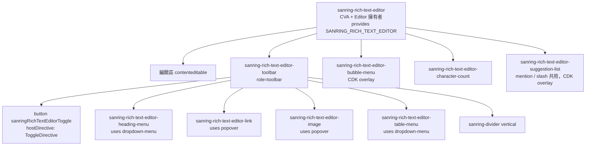

# PRD: Rich Text Editor（Tiptap）

## 1. 背景 (Background)

- **現況**：sanring/ui 能輸入多行文字的只有 `textarea`（`registry/components/textarea/textarea.directive.ts`，純文字、`SanringFieldControl` 薄 API）。沒有任何格式化文字的能力，所以有後台內容編輯、留言、說明欄位等需求的消費端只能自己整合第三方編輯器。整合後的樣式與 `--sanring-*` token、`sanring-field` 表單整合、a11y 慣例都對不上。
- **Angular 生態缺口**：Tiptap 官方沒有 Angular binding。社群的 `ngx-tiptap` 是另一層依賴與維護風險。sanring 的 registry 是「原始碼複製進消費端」的 shadcn 範式，適合直接以 `@tiptap/core` 自寫薄殼，讓消費端擁有程式碼。
- **既有前例**：
  - 第三方引擎以 `peerDependencies` 宣告、`sanring add` 自動安裝：`carousel` → `embla-carousel@^8.6.0`；`org-chart` → `elkjs@^0.12.0`（決策見 `.claude/adrs/0002-org-chart-layout-engine.md`）。
  - SSR 安全的第三方初始化寫法：`registry/components/carousel/carousel-content.component.ts`（`afterNextRender` 內建立引擎、destroy 時清理）。
- **與 P32 方向的關係（已拍板：破例）**：`TODOLIST.md` P32「明確不做」寫著「新 primitive……官方方向在 blocks 與 registry 生態，不在再堆元件」。rich-text-editor 不是重複既有能力的 primitive，而是 `textarea` 無法涵蓋的缺口，因此破例新增，開 **P34**，歸入 `patterns` 群組。TODOLIST 需註明破例理由。

## 2. 目標 (Goals)

- **業務目標**：
  - 讓消費端用一行 `sanring add rich-text-editor` 取得可放進 `sanring-field`、可綁 Reactive Forms 的富文本編輯器，不用自行整合 Tiptap。
  - 採用指標：TODO（目前 repo 內沒有元件採用率量測機制，無法定義可量測門檻）。
- **技術目標**：
  - SSR 安全：server 端不建立 `Editor`、不存取 `window`/`document`（對齊 audit-component Phase 1-B）。
  - Tiptap / ProseMirror 只出現在 `rich-text-editor` 目錄內，不影響未使用此元件的消費端 bundle（registry 安裝與 `@sanring/ui` 單一 entry 皆須驗證 tree-shaking）。
  - 實際 bundle 增量：unknown，M0 spike 量測後寫入 ADR，並在 docs 揭露（比照 org-chart 揭露 worker 體積）。
  - 通過 `/audit-component` 工程裁決 ✅、`check-registry-parity.mjs` 綠、docs axe 零違規。
- **使用者目標**：
  - 開發者：照 docs 範例 5 分鐘內完成「工具列 + 表單綁定」組裝（主觀目標，無量測機制）。
  - 終端使用者：只用鍵盤就能完成所有格式化操作（toolbar 方向鍵導覽、快捷鍵、選單 Escape 關閉且焦點回到編輯區）。

## 3. 範圍 (Scope) vs 非範圍 (Non-Goals)

### ✅ 範圍
- [ ] 核心編輯器 `sanring-rich-text-editor`：以 `@tiptap/core` 建立 `Editor`，載入 `@tiptap/starter-kit` 全部擴充（v3 StarterKit 已內含 Link / Underline / ListKeymap，見 §9 版本風險）
- [ ] 表單整合：ControlValueAccessor（延伸 `registry/shared/cva-base.ts` 的 `SanringCvaBase<string>`），值格式為 **HTML 字串**，空內容正規化為 `''`；以 `SanringFieldControlAdapter` 接 `sanring-field`（label / description / error-message / `aria-describedby`）
- [ ] 可組合工具列：`sanring-rich-text-editor-toolbar`（`role="toolbar"`）+ 個別按鈕元件，消費端自選按鈕組合；重用 `toggle`、`dropdown-menu`、`popover`、`tooltip`、`divider` 作為 componentDeps
- [ ] Placeholder（`@tiptap/extensions` 的 `Placeholder`）
- [ ] 唯讀 / disabled（`editor.setEditable(false)` + `aria-readonly` / `aria-disabled`）
- [ ] 字數 / 字元統計含上限（`@tiptap/extensions` 的 `CharacterCount`，`limit` 選項）
- [ ] 連結：插入 / 編輯 / 移除（URL 輸入介面重用 `popover`），限制 protocol
- [ ] 圖片：以 URL 插入（`@tiptap/extension-image`），加可選的 upload callback 介面（只定義介面，不實作上傳）
- [ ] Bubble menu：選取文字時浮出格式化選單（CDK overlay）
- [ ] 表格：插入表格、增刪列欄、合併 / 分割儲存格、表頭切換（`@tiptap/extension-table`）
- [ ] Mention（`@`）與 Slash 指令（`/`）：資料來源由消費端提供（Promise / Observable），浮動建議清單（CDK overlay）支援鍵盤導覽
- [ ] 內容排版樣式：Tailwind 自寫（只用 `var(--sanring-*)` token），不引 `@tailwindcss/typography`
- [ ] 同時交付 `packages/ui`（`@sanring/ui`）與 `registry/`，通過 `check-registry-parity.mjs`
- [ ] `registry.json` 條目（`peerDependencies` + `componentDeps` + `sharedDeps`）、docs 元件頁、單元測試、Playwright e2e、CLI peer 安裝測試、changeset

### ❌ 非範圍（明確不做，避免 scope creep）
- ❌ 即時協作（Yjs / `@tiptap/extension-collaboration` / Hocuspocus / Tiptap Cloud）
- ❌ AI 功能（Tiptap Content AI、AI 補全 / 改寫）
- ❌ 評論 / 批註（Tiptap Comments 等）
- ❌ Tiptap Pro / 付費 / 需 Tiptap Cloud 授權的任何擴充
- ❌ Markdown 輸入 / 輸出（值格式已定為 HTML；Markdown 轉換交給消費端）
- ❌ JSON（ProseMirror doc）作為 CVA 值格式（v1 只支援 HTML 字串；JSON 輸出列為 Follow-up）
- ❌ 後端 HTML sanitize 實作，以及任何伺服器端元件（上傳 API、mention 搜尋 API）
- ❌ 圖片實際上傳後端、圖片裁切 / 縮放把手、圖片儲存管理
- ❌ 依賴 `ngx-tiptap` 或其他 Angular Tiptap 包裝套件
- ❌ `@tiptap/extension-bubble-menu`，以及直接使用 `@floating-ui/dom` 定位（浮動 UI 統一走 CDK overlay；`@floating-ui/dom` 僅作為 `@tiptap/suggestion` 的傳遞 peer 存在）
- ❌ `@tailwindcss/typography`
- ❌ 自訂 Angular NodeView（以 Angular 元件渲染 ProseMirror node）
- ❌ 拼字檢查、翻譯、匯出 PDF / Word、版本歷程 / diff
- ❌ 改動 `packages/cli`（peer 安裝走既有 `collectPeerDeps` 機制，與 ADR-0002 相同；只新增測試案例）

## 4. 使用者故事 (User Stories)

### Story 1: 以表單控制項使用富文本編輯器（M1）

- **As a** Angular 開發者（消費端）
- **I want to** 把 `sanring-rich-text-editor` 放進 `sanring-field` 並綁 `formControl`
- **So that** 富文本欄位與 input / textarea 共用同一套 label、驗證、錯誤訊息流程

**Acceptance Criteria**:
- [ ] Given 一個 `FormControl<string>` 初值為 `'<p>Hello</p>'`，when 元件初始化，then 編輯區顯示「Hello」，且不觸發 `onChange`（writeValue 不回寫）
- [ ] Given 使用者輸入文字，when 內容改變，then control 值更新為 HTML 字串，`control.dirty === true`
- [ ] Given 編輯器內容被清空，when 讀取 control 值，then 值為 `''`（不是 `'<p></p>'`）
- [ ] Given control 有 `Validators.required` 且已 touched、內容為空，when 渲染，then 宿主有 `aria-invalid="true"`，`sanring-error-message` 顯示，且 `aria-describedby` 指向錯誤訊息 id
- [ ] Given 編輯區失焦，when blur，then `control.touched === true`
- [ ] Given `control.disable()`，when 渲染，then 編輯區不可編輯（`contenteditable="false"`）、工具列按鈕全部 disabled、宿主有 `aria-disabled="true"`
- [ ] Given 外部 `control.setValue(newHtml)`，when 值改變，then 編輯區內容更新、游標不跳到不合理位置，且不觸發回寫迴圈

### Story 2: 用可組合工具列格式化內容（M1）

- **As a** 開發者
- **I want to** 只放我需要的按鈕（如粗體、斜體、標題、清單）
- **So that** 不同場景（留言 vs 文章）有不同的工具列密度

**Acceptance Criteria**:
- [ ] Given toolbar 內放了粗體按鈕，when 游標在粗體文字內，then 按鈕 `aria-pressed="true"`、`data-state="on"`
- [ ] Given 焦點在 toolbar 第一顆按鈕，when 按右方向鍵 / 左方向鍵 / Home / End，then 焦點依 WAI-ARIA toolbar pattern 在按鈕間移動（roving tabindex，toolbar 只佔一個 Tab stop）
- [ ] Given toolbar 有 `role="toolbar"` 與 `aria-label`（或 `aria-labelledby`）、`aria-controls` 指向編輯區，when axe 掃描，then 零違規
- [ ] Given 每顆 icon-only 按鈕，when 渲染，then 有 `aria-label`，hover / focus 時以 `tooltip` 顯示名稱與快捷鍵
- [ ] Given 標題下拉（`dropdown-menu`），when 選「Heading 2」，then 當前段落轉為 `<h2>`，選單關閉、焦點回到編輯區
- [ ] Given 某指令在目前狀態不可執行（`editor.can()` 為 false），when 渲染，then 按鈕 disabled，且方向鍵導覽跳過該按鈕
- [ ] Given 使用者按 `Mod-B` / `Mod-I` 等 StarterKit 預設快捷鍵，when 在編輯區，then 格式套用且對應按鈕狀態同步

### Story 3: Placeholder、唯讀、字數上限（M1）

- **As a** 開發者
- **I want to** 設定 placeholder、唯讀模式與字元上限
- **So that** 能涵蓋留言框與檢視模式

**Acceptance Criteria**:
- [ ] Given `placeholder="寫點什麼…"` 且內容為空，when 渲染，then 空段落顯示 placeholder（CSS `::before` + `data-placeholder`），且編輯區有 `aria-placeholder`
- [ ] Given `readonly` 為 true，when 渲染，then 可選取與複製但不可編輯，工具列按鈕全部 disabled（不隱藏），宿主有 `aria-readonly="true"`
- [ ] Given `maxCharacters=200` 且已有 200 字元，when 再輸入，then 輸入被阻擋（CharacterCount `limit`）
- [ ] Given `sanring-rich-text-editor-character-count` 已放置，when 內容改變，then 顯示 `n/200`，並以 `aria-live="polite"` 宣告（比照 textarea docs 的 character-count 範例）
- [ ] Given 貼上超出上限的內容，when paste，then 從游標處截斷到上限（CharacterCount 預設；截斷後仍超限則拒絕）
- [ ] Given `maxCharacters=200` 且 control 寫入 300 字的 HTML，when `writeValue`，then 300 字全部顯示、**不截斷**（`autoTrim: false`），control 值不變；字數顯示 `300/200` 並使用錯誤色；不能再輸入，但可以刪減

### Story 4: SSR 安全（M1）

- **As a** 使用 Angular SSR 的開發者
- **I want to** 在 SSR 頁面使用編輯器而不出錯
- **So that** server render 不會因瀏覽器 API 而失敗

**Acceptance Criteria**:
- [ ] Given SSR 環境，when 元件在 server 渲染，then 不呼叫 `new Editor()`、不存取 `window` / `document`，輸出 skeleton 佔位（§8 初始化前狀態）
- [ ] Given 瀏覽器 hydrate，when `afterNextRender` 執行，then 建立 `Editor`，並套用 CVA 在初始化前收到的值（排隊值）
- [ ] Given 元件銷毀，when `DestroyRef.onDestroy`，then 呼叫 `editor.destroy()`，所有 editor event listener 與 overlay 都已釋放
- [ ] Given docs 元件頁 `*.docs.ts`，when 定義頁面，then `ssrSafe: true`（比照 `carousel.docs.ts`）

### Story 5: 連結（M2）

- **As a** 終端使用者
- **I want to** 為選取文字加上 / 編輯 / 移除連結
- **So that** 能引用外部資源

**Acceptance Criteria**:
- [ ] Given 選取文字，when 按連結按鈕（或 `Mod-K`，TODO 見 §12），then 開啟 `popover`，焦點進入 URL 輸入框
- [ ] Given 輸入 `https://example.com` 並送出，when 套用，then 選取範圍成為 `<a href="https://example.com">`，popover 關閉、焦點回到編輯區
- [ ] Given 輸入 `javascript:alert(1)`，when 套用，then 拒絕套用並顯示錯誤訊息（protocol 白名單：`http`、`https`、`mailto`；TODO：最終清單見 §12）
- [ ] Given popover 開啟，when 按 Escape，then popover 關閉、焦點回到觸發按鈕（既有 popover 行為）
- [ ] Given 游標在既有連結內，when 開啟連結編輯，then 預填既有 href，並提供「移除連結」

### Story 6: 圖片（M2）

- **As a** 終端使用者
- **I want to** 以 URL 插入圖片，或在消費端提供上傳函式時直接選檔
- **So that** 內容能包含圖片

**Acceptance Criteria**:
- [ ] Given 圖片按鈕，when 輸入 URL 與替代文字（alt）並送出，then 插入 ``
- [ ] Given 消費端未提供 `imageUpload`，when 渲染，then 不顯示「上傳」選項
- [ ] Given 消費端提供 `imageUpload: (file: File) => Promise<string>`，when 選檔，then 呼叫 callback，以 resolve 的 URL 插入圖片
- [ ] Given upload callback reject，when 失敗，then 顯示錯誤（§8 錯誤態），不插入圖片，emit `imageUploadError`
- [ ] Given 圖片 URL 載入失敗（`img` `error` 事件），when 渲染，then 顯示錯誤樣式（TODO：實作方式待 spike；Image 擴充預設不提供 error hook）
- [ ] Given 貼上 / 拖放圖片檔，when 有 `imageUpload`，then 行為待決（TODO 見 §12）

### Story 7: Bubble menu（M2）

- **As a** 終端使用者
- **I want to** 選取文字時直接在旁邊看到常用格式按鈕
- **So that** 不用移到頂部工具列

**Acceptance Criteria**:
- [ ] Given 非空選取（文字範圍），when 選取完成，then bubble menu 以 CDK overlay 出現在選取範圍上方，空間不足時翻到下方
- [ ] Given bubble menu 開啟，when 打字或選取收合，then 自動隱藏
- [ ] Given bubble menu 開啟，when 鍵盤使用者要進入選單，then 有明確的進入方式（TODO：建議 `Alt+F10`，見 §12）
- [ ] Given bubble menu 內按鈕，when 渲染，then 與 toolbar 共用同一套按鈕元件（`role="toolbar"`、`aria-pressed`）
- [ ] Given 頁面上另有已開啟的 `dropdown-menu` / `popover`，when bubble menu 顯示，then 疊層順序正確，且 outside-click 不會誤關對方

### Story 8: 表格（M3）

- **As a** 終端使用者
- **I want to** 插入並編輯表格
- **So that** 能呈現結構化資料

**Acceptance Criteria**:
- [ ] Given 表格按鈕，when 插入，then 預設建立 3×3 含表頭列的表格（TODO：預設尺寸見 §12）
- [ ] Given 游標在表格內，when 開啟表格操作選單（`dropdown-menu`），then 可新增 / 刪除列欄、合併 / 分割儲存格、切換表頭、刪除表格；不適用的項目 disabled
- [ ] Given 游標在儲存格，when 按 Tab / Shift+Tab，then 在儲存格間移動（Table 擴充預設行為）；最後一格按 Tab 的行為依擴充預設
- [ ] Given 表格已渲染，when 輸出 HTML，then 為語意化 `<table><tbody><tr><th>/<td>`
- [ ] Given 欄寬調整（`resizable`），when 是否啟用，then TODO（見 §12，預設建議關閉以降低複雜度）

### Story 9: Mention 與 Slash 指令（M4）

- **As a** 終端使用者
- **I want to** 輸入 `@` 提及人員、輸入 `/` 叫出插入指令
- **So that** 能快速引用對象與插入區塊

**Acceptance Criteria**:
- [ ] Given 輸入 `@ja`，when 觸發，then 以 query `ja` 呼叫消費端的 `mentionItems`，浮動清單（CDK overlay）顯示結果
- [ ] Given 清單開啟，when 按上下方向鍵 / Enter / Escape，then 移動 active 項目、插入 mention node、關閉清單；**焦點始終留在編輯區**（以 `aria-activedescendant` 指向 active 選項，清單 `role="listbox"`、選項 `role="option"` + `aria-selected`）
- [ ] Given 資料來源 pending，when 等待，then 清單顯示 loading 狀態
- [ ] Given 資料來源 reject / error，when 失敗，then 清單顯示錯誤訊息，不插入，emit `suggestionError`
- [ ] Given 結果為空，when 渲染，then 顯示 empty 狀態（重用 `shared/collection-state.ts` 的概念）
- [ ] Given 連續快速輸入，when 前一個請求尚未回來，then 舊結果不會覆蓋新結果（取消或忽略過期回應）
- [ ] Given 輸入 `/`，when 觸發，then 列出消費端提供的 `slashCommands`（可依 query 過濾），選擇後執行 `run(ctx)` 並刪除觸發文字
- [ ] Given mention 插入完成，when 輸出 HTML，then 為 Mention 擴充預設格式的 `<span data-type="mention" data-id data-label>`（TODO：M0 spike 確認 v3 輸出屬性）

### Story 10: 安裝與文件（每個 milestone）

- **As a** 開發者
- **I want to** `sanring add rich-text-editor` 一次裝好所有 peer 與 componentDeps，或直接從 `@sanring/ui` 匯入
- **So that** 不用手動對齊 Tiptap 套件版本

**Acceptance Criteria**:
- [ ] Given CLI `collectPeerDeps`，when 收集 rich-text-editor，then 包含所有 `@tiptap/*` peer，版本範圍一致（新增測試，比照 `packages/cli/src/commands/add.test.ts` 的 elkjs 案例與 dry-run 案例）
- [ ] Given `sanring add rich-text-editor --dry-run`，when 執行，then log 列出 `Would install: npm install @tiptap/core@… @tiptap/pm@… @tiptap/starter-kit@…`
- [ ] Given componentDeps，when 安裝，then `toggle`、`dropdown-menu`、`popover`、`tooltip`、`divider`、`field` 一併安裝
- [ ] Given `packages/ui` 版本，when 執行 `check-registry-parity.mjs`，then 與 registry 版本一致；`@tiptap/*` 在 `@sanring/ui` 的宣告方式依 ADR-0003（dependencies 時另加 `ng-package.json` `allowedNonPeerDependencies`，比照 embla）
- [ ] Given docs 元件頁，when 開啟，then 有 basic / usage / installation / composition / examples / API / accessibility 區段（比照 `carousel.docs.ts`），並揭露 bundle 體積與 HTML sanitize 責任
- [ ] Given Playwright docs e2e，when 執行 `pnpm test:e2e:docs`，then 輸入、格式化、表單值、鍵盤導覽案例通過，`component-page-accessibility.spec.ts` axe 掃描零違規

## 5. 技術選型 (Tech Stack)

> **唯一固定預設：Tailwind CSS**（樣式層）。本專案為既有 repo，以下沿用既有偵測結果與使用者已拍板的選型。

| 層 | 選型 | 理由 |
|---|---|---|
| Frontend | Angular 22（standalone、signals、OnPush） | 既有專案（根 `package.json` `@angular/core ^22.0.0`） |
| 編輯器引擎 | `@tiptap/core` + `@tiptap/pm` + `@tiptap/starter-kit`（MIT），**不用** `ngx-tiptap` | 使用者拍板；直接用 core 寫薄殼，消費端擁有原始碼、少一層第三方維護風險 |
| 編輯器擴充（開源） | `@tiptap/extensions`（Placeholder、CharacterCount）、`@tiptap/extension-image`、`@tiptap/extension-table`、`@tiptap/extension-mention`、`@tiptap/suggestion`；Link 已含於 v3 StarterKit | 只用開源擴充，排除 Pro；套件名依 Tiptap v3 upgrade guide，最終清單由 M0 spike 確認 |
| 浮動 UI 定位 | `@angular/cdk/overlay`，沿用 `shared/menu-overlay-controller.ts`（已支援 `{x,y}` origin）+ `shared/collection-controller.ts`（active-descendant） | 使用者拍板；與既有 overlay 堆疊 / outside-click 一致；細節寫入 ADR-0003 |
| Backend | N/A | 純前端元件 |
| DB | N/A | — |
| UI 庫 | sanring/ui 自身 registry（shadcn 範式）+ `@sanring/ui` 套件 | 既有專案；工具列重用 `toggle` / `dropdown-menu` / `popover` / `tooltip` / `divider` |
| CSS | **Tailwind CSS（固定）** v4；內容排版自寫，不引 `@tailwindcss/typography` | sanring 唯一鎖定預設；只用 `var(--sanring-*)` token |
| Icon | `@lucide/angular ^1.18.0` | 既有 registry 慣例 peer |
| 表單 | `@angular/forms ^22.0.0` + `shared/cva-base.ts` | 既有表單元件慣例 |
| Cache / Auth / 監控 | N/A | — |
| Deploy | registry 經 `@sanring/cli` 的 `sanring add` 發佈；`@sanring/ui` 以 dependencies 宣告 `@tiptap/*`（比照 embla，單一 entry）；Tiptap 不進 CLI tarball | 使用者拍板雙份交付；CLI 部分比照 ADR-0002 決策 6 |

## 6. 資料模型 (Data Model)

> 本功能沒有 DB schema。本段改寫為**元件公開 API 與值模型**。selector 前綴依既有慣例：元素用 `sanring-*`，屬性指令用 `[sanring*]`。以下為提案，最終命名在 M1 實作時以 `/audit-component` 驗證。

### 契約變動

- `registry/components/field/field.type.ts`（與 `packages/ui` 對應檔）的 `FieldType` 新增 `richTextEditor: 'rich-text-editor'`
- `registry/registry.json` `components[]` 新增 `rich-text-editor`，加進 `patterns` 群組
- `packages/ui` 新增 `rich-text-editor` entry，`package.json` 與 `ng-package.json` 加入 `@tiptap/*`

### 主要實體與關係（元件組合）



### 元件職責邊界

- **擁有者**：`RichTextEditorComponent`，唯一 `new Editor()` 與 `editor.destroy()` 的地方
- **子元件**：toolbar、各按鈕、bubble menu、character count、suggestion list，一律透過注入 `SANRING_RICH_TEXT_EDITOR` 取得 context，**不直接持有 `Editor` 參考**，也不自建 Editor
- **值物件**：HTML 字串（CVA 值）、`RichTextEditorMentionItem`、`RichTextEditorSlashCommand`
- **引擎隔離**：比照 ADR-0002 決策 3，只有 root（及必要的 extension 設定檔）`import '@tiptap/*'`；子元件透過 context 暴露的 signal / command 方法操作

## 7. API 契約 (API Contract)

> 本段改寫為**元件公開 API**（inputs / outputs / CVA / 注入 token）。全部用 signal `input()` / `output()` / `model()`（audit-component Phase 3）。

### `sanring-rich-text-editor`（root）

| 類別 | 名稱 | 型別 | 預設 | 說明 |
|---|---|---|---|---|
| input | `id` | `string \| undefined` | 自動產生 | 供 `<label for>` 與 field 關聯 |
| input | `class` | `string \| undefined` | — | `cn()` 合併 |
| input | `contentClass` | `string \| undefined` | — | 編輯區 class |
| input | `placeholder` | `string \| undefined` | — | Placeholder 擴充 |
| input | `readonly` | `boolean` | `false` | `setEditable(false)`，可選取 |
| input | `disabled` | `boolean` | `false` | 與 CVA `setDisabledState` 合併 |
| input | `required` | `boolean` | `false` | 覆寫 `hasInputRequired()` |
| input | `maxCharacters` | `number \| undefined` | — | CharacterCount `limit` |
| input | `ariaLabel` / `ariaLabelledBy` / `ariaDescribedBy` | `string \| undefined` | — | 綁在 contenteditable 元素（`role="textbox"` `aria-multiline="true"`） |
| input | `extensions` | `AnyExtension[]` | `[]` | 額外開源擴充（逃生口；消費端自行 import 的擴充進入其自身 bundle） |
| input | `linkProtocols` | `string[]` | `['http','https','mailto']` | M2 |
| input | `imageUpload` | `((file: File) => Promise<string>) \| undefined` | — | M2；回傳可用 URL |
| input | `mentionItems` | `((query: string) => Promise<RichTextEditorMentionItem[]> \| Observable<RichTextEditorMentionItem[]>) \| undefined` | — | M4 |
| input | `slashCommands` | `RichTextEditorSlashCommand[] \| ((query: string) => …)` | — | M4 |
| output | `editorReady` | `Editor` | — | 逃生口：拿到原生 Tiptap 實例（非同步初始化完成後 emit） |
| output | `focusChange` | `boolean` | — | — |
| output | `imageUploadError` | `unknown` | — | M2 |
| output | `suggestionError` | `{ kind: 'mention' \| 'slash'; error: unknown }` | — | M4 |

**CVA 行為**（值只走 CVA；非表單情境用 `ngModel` 或獨立 `FormControl`，不提供 `[(value)]` model）：
- `writeValue(html)`：editor 未建立時排隊，建立後 `setContent` 且**不 emit update**（v3 `setContent` 參數簽章 M0 spike 確認）
- `onChange`：在 editor `update` 事件時呼叫，值為 `editor.getHTML()`；`editor.isEmpty` 時回傳 `''`
- `onTouched`：在 editor `blur` 時呼叫（`SanringCvaBase.onBlur`）
- `setDisabledState`：同步 `setEditable`
- 提供 `SANRING_FIELD_CONTROL`（`SanringFieldControlAdapter`，`controlType: FieldType.richTextEditor`）

### 型別

```ts
interface RichTextEditorMentionItem { id: string; label: string; description?: string; avatarUrl?: string }
interface RichTextEditorSlashCommand {
  id: string; title: string; description?: string; keywords?: string[];
  icon?: unknown; // TODO：lucide icon 型別待定
  run: (ctx: RichTextEditorContext) => void;
}
```

### 注入 token

| Token | 提供者 | 內容 |
|---|---|---|
| `SANRING_RICH_TEXT_EDITOR` | root | `RichTextEditorContext`：`editor: Signal<Editor \| null>`、`state: Signal<number>`（transaction 版本號，觸發 computed 重算）、`isActive(name, attrs?)`、`can(command)`、`run(command)`、`disabled: Signal<boolean>`、`contentId` |
| `SANRING_FIELD_CONTROL` | root | 既有 token |

### 子元件

| Selector | 說明 | 主要 inputs |
|---|---|---|
| `sanring-rich-text-editor-toolbar` | `role="toolbar"`、roving tabindex | `ariaLabel`、`orientation`、`class` |
| `button[sanringRichTextEditorToggle]` | 透過 `hostDirectives` 套 `ToggleDirective`，`pressed` 由 context 推導 | `sanringRichTextEditorToggle: 'bold' \| 'italic' \| 'underline' \| 'strike' \| 'code' \| 'bulletList' \| 'orderedList' \| 'blockquote' \| 'codeBlock'`、`ariaLabel` |
| `button[sanringRichTextEditorAction]` | 非切換型指令（undo / redo / horizontalRule / hardBreak / clearFormatting） | 同上 |
| `sanring-rich-text-editor-heading-menu` | `dropdown-menu` 選段落 / H1–H6 | `levels` |
| `sanring-rich-text-editor-link` | M2，`popover` 表單 | — |
| `sanring-rich-text-editor-image` | M2，`popover` 表單 + 可選上傳 | `accept` |
| `sanring-rich-text-editor-bubble-menu` | M2，CDK overlay，內容由 `ng-content` 投影按鈕 | `side` |
| `sanring-rich-text-editor-table-menu` | M3 | `defaultRows`、`defaultCols` |
| `sanring-rich-text-editor-character-count` | 顯示 `n/limit` | `mode: 'characters' \| 'words'` |

統一回應格式：不適用（無 HTTP API）。

## 8. UI 流程 (UI Flow)

主要情境與**四態**（對應 loading / empty / error / success）：

- **編輯器本體**
  - **初始化前（loading）**：server render 與 `afterNextRender` 之前顯示 `skeleton` 佔位（與編輯區同高，`aria-busy="true"`）；工具列按鈕 disabled。不以靜態 HTML 預渲染初值（XSS 疑慮）
  - **空內容（empty）**：顯示 placeholder；character count 顯示 `0/limit`
  - **錯誤（error）**：表單驗證失敗時邊框改 `--sanring-error-50`（比照 textarea `errorState` 樣式）；字數超限時 count 文字改錯誤色
  - **正常（success）**：可編輯；工具列狀態隨 transaction 同步
  - 唯讀 / disabled：`opacity-50`（disabled）或無邊框檢視（readonly，樣式 B3 定案）
- **連結 popover（M2）**：URL 驗證錯誤顯示 inline 錯誤訊息；成功後關閉並把焦點還給編輯區
- **圖片（M2）**：上傳中（插入按鈕 spinner）→ 失敗（popover 內錯誤訊息）→ 成功（插入）；已插入圖片載入失敗則顯示錯誤外框與 alt 文字（TODO：實作方式 spike）
- **Mention / Slash 清單（M4）**：loading（spinner 列）/ empty（「無結果」）/ error（錯誤訊息 + 可重試，TODO）/ success（listbox）

對應 Figma / design assets：無（`design_output_mode: assets_only`）

關鍵互動的 `data-testid` 預埋清單（已拍板使用 `data-testid`）：
- 編輯區：`rte-content`
- 工具列：`rte-toolbar`；按鈕：`rte-btn-<command>`（如 `rte-btn-bold`）
- 字數：`rte-character-count`
- 連結 / 圖片 popover：`rte-link-form`、`rte-image-form`；錯誤訊息：`rte-link-error`、`rte-image-error`
- Bubble menu：`rte-bubble-menu`
- 建議清單：`rte-suggestion-list`；錯誤：`rte-suggestion-error`

## 9. 風險與相依 (Risks & Dependencies)

### 風險

| 風險 | 影響 | 緩解 |
|---|---|---|
| **HTML 值與 XSS**：CVA 輸出 HTML 字串，消費端若以 `innerHTML` 渲染或後端直接回吐，可能被注入（貼上的惡意 HTML、`javascript:` 連結、`img onerror`） | high | ProseMirror schema 會丟棄未定義的節點與屬性，但**這不是 sanitize 保證**。docs 明確寫出 **sanitize 是消費端 / 後端的責任**（建議伺服器端白名單 sanitize）；Link 限制 protocol；Image 只接受 `http(s)` / 相對 URL（TODO 白名單）；docs 範例渲染輸出時用 Angular 內建 sanitizer，不用 `bypassSecurityTrustHtml` |
| **Bundle size**：ProseMirror + Tiptap + table / mention 擴充體積不小 | med | M0 spike 量測各 milestone 增量並寫入 ADR 與 docs；確認 `@sanring/ui` 未 import rte 的消費端不會被拖入（tree-shaking）；不設數字門檻，硬性要求不進 initial chunk |
| **`@sanring/ui` 依賴膨脹**：`@tiptap/*` 列為 `@sanring/ui` 的 dependencies，所有安裝 `@sanring/ui` 的人都會下載 | low | `@sanring/ui` 目前 private 不發版，影響僅限本 repo；未來對外發佈時重評（optional peer 需 secondary entry，須改 CLI 腳本） |
| **Tiptap 主版本選擇**：目前主線為 v3（`npm view` 確認 `@tiptap/core` 最新為 3.31.4，2026-09-30）。v3 破壞性變更：StarterKit 內含 Link / Underline / ListKeymap、`History` 改名 `UndoRedo`、Placeholder / CharacterCount 移到 `@tiptap/extensions`、選單由 tippy.js 改為 `@floating-ui/dom`、移除 UMD | med | 鎖 v3；peer 範圍以 3.31.4 為基準，最終範圍寫入 ADR-0003；實作時對照 v3 文件，不參考 v2 範例 |
| **peer 版本對齊**：所有 `@tiptap/*` 必須同版本，否則 `@tiptap/pm` 重複實例會造成 schema / plugin key 衝突 | med | registry `peerDependencies` 與 `@sanring/ui` 的宣告全部用同一版本範圍；CLI 測試驗證；docs 提醒升級時一起升 |
| **Angular 相容**：編輯區 DOM 由 ProseMirror 控制，Angular 不能在 contenteditable 內渲染；zoneless / OnPush 下 editor 事件不會自動觸發變更偵測 | med | editor 掛在 `ElementRef` 子節點且 Angular 範本不碰其內容；以 `transaction` 事件更新 signal 版本號驅動 computed；特定相容問題 unknown（M0 驗證） |
| **浮動 UI 與既有 overlay 衝突**：既有 `popover` 開啟時是 `role="dialog"` 且會把焦點移進面板，**不適合 mention / slash / bubble**（打字時焦點必須留在編輯區） | med | 已拍板統一走 CDK overlay：用 `flexibleConnectedTo({x,y,width,height})` 定位到選取範圍座標（`editor.view.coordsAtPos` / suggestion 的 `clientRect`），沿用 `menu-overlay-controller` lifecycle 與 `collection-controller` 鍵盤模型；連結 / 圖片表單需要焦點進入，維持用 `popover` |
| **v3 StarterKit 內含 Link** 與 M2 的 Link UI 切分衝突 | low | 已拍板：M1 以 `StarterKit.configure({ link: false })` 停用（v3 設定鍵名 M0 確認），M2 連同 protocol 白名單再開 |
| **packages/ui 與 registry 雙份同步** | med | 受 `check-registry-parity.mjs` 約束；每個 milestone 驗收都要求 parity 綠 |
| **a11y 複雜度**（contenteditable + toolbar + 浮動清單 + 表格） | med | 每個 milestone 都要求 axe 零違規與鍵盤 e2e；Tier 3（使用 CDK Overlay）審查 |
| **授權**：Tiptap 開源套件為 MIT；Pro 擴充需另外授權 | low | 只裝 `@tiptap/*` 開源套件；M0 逐一確認各套件 `license` 欄位（TODO） |

### 相依

- **上游**：
  - `toggle`、`dropdown-menu`（`@angular/aria/menu`）、`popover`、`tooltip`、`divider`、`field`、`skeleton`（初始化前狀態，TODO：是否列入 componentDeps）
  - `shared/cva-base.ts`、`shared/utils.ts`、`shared/component-styles.ts`；M2/M4 用到 `menu-overlay-controller`、`collection-controller`、`collection-state`
  - `field.type.ts` 新增 `FieldType.richTextEditor`
  - CLI 既有 `collectPeerDeps`（不改 CLI 程式碼）
- **下游**：
  - 消費端（`sanring add rich-text-editor` 或 `@sanring/ui`）
  - docs app（新元件頁、`stage-registry.mjs` 會自動攤平）
  - P19 blocks（例如 `detail-page` / `settings-page` 未來可能使用；目前未規劃）
  - `check-registry-sync.mjs` / `check-registry-parity.mjs`

## 10. 里程碑 (Milestones)

**切法理由**（已拍板 2026-10-13）：
1. **M0 是 gate，不出貨**：Tiptap v3 + Angular 22 + SSR + bundle 量測都還沒驗證，比照 ADR-0002 先 spike 再決定。
2. **M1 是 tracer bullet**：從 `sanring add` / `@sanring/ui` → 元件 → CVA → field → docs → e2e 打通端到端，只放 StarterKit。之後每片 slice 都在這條鏈路上加功能。
3. **M2 把 Link / Image / Bubble menu 放一起**：三者都需要「浮動 UI + URL 輸入」的同一組基礎設施，一起做可以一次定案 selection-anchored overlay。
4. **M3 Table 獨立**：只依賴 M1 的工具列與 `dropdown-menu`。複雜度與 a11y 風險高，單獨一片可以獨立回退。
5. **M4 Mention / Slash 放最後**：需要 M2 定案的 overlay 定位與 active-descendant 鍵盤模型；Slash 指令要能插入表格 / 圖片，依賴 M2、M3。
6. M2 與 M3 彼此無依賴，可平行或對調。

| Milestone | 預計完成 | 內容 | 驗收門檻 |
|---|---|---|---|
| M0 Spike / ADR | TODO | docs 暫時頁：Tiptap v3 + StarterKit 在 Angular 22 建立 / 銷毀；SSR build 不報錯；量測 bundle 增量（M1 組合 + 全擴充組合，registry 與 `@sanring/ui` 兩條路徑）；確認 v3 套件名、`setContent` 簽章、StarterKit 停用 Link 的方法；CDK overlay 定位到選取範圍的 PoC；寫 ADR-0003 | ADR-0003 Accepted；暫時頁刪除；任一 gate 不過就停工回報 |
| M1 核心 tracer bullet | 完成（2026-10-13） | root 元件 + CVA + field 整合 + StarterKit（Link 停用）+ toolbar（toggle / action / heading-menu / divider / tooltip）+ placeholder + readonly/disabled + character count + 內容排版樣式 + registry 條目 + `packages/ui` entry + docs 頁 + CLI peer 測試 + changeset | `pnpm lint`、`pnpm test` 綠；`check-registry-parity.mjs` 綠；`/audit-component rich-text-editor` 工程裁決 ✅；Story 1–4、10 的 AC 全過；`pnpm test:e2e:docs`（含 axe）與 `pnpm test:e2e:cli` 綠 |
| M2 Link + Image + Bubble menu | TODO | Link UI（popover）+ protocol 驗證；Image（URL + `imageUpload` 介面）；bubble menu（CDK overlay）；peer 新增 `@tiptap/extension-image` | Story 5–7 AC；XSS 案例測試（`javascript:` 被拒）；axe 零違規；overlay 與既有 dropdown / popover 同頁共存的 e2e |
| M3 Table | TODO | `@tiptap/extension-table` + 表格操作選單 + 表格樣式 | Story 8 AC；鍵盤 Tab 導覽 e2e；axe 零違規 |
| M4 Mention + Slash | TODO | `@tiptap/extension-mention` + `@tiptap/suggestion`；共用 suggestion list（CDK overlay + listbox + active-descendant）；Slash 指令由 suggestion 自寫 extension；Promise / Observable 資料來源與過期回應處理 | Story 9 AC；四態 e2e；焦點始終在編輯區；axe 零違規 |

## 11. 後續追蹤 (Follow-ups)

- M1 出貨後：用 `/audit-component` Phase 6 收集 consumer usage 證據（目前沒有採用率量測，TODO）
- 評估 JSON（ProseMirror doc）值格式的 opt-in input（`valueFormat: 'html' \| 'json'`）
- 評估 Markdown 輸入 / 輸出（目前非範圍）
- Tiptap 主版本升級時：重新驗證 peer 範圍與 ADR-0003 推翻條件
- 若出現第二個需要「選取範圍定位浮動 UI」的元件，評估把 selection-anchored overlay 抽成 `shared/`
- 90 天：檢視 ADR-0003 是否需要 supersede

## 12. 開放問題 (Open Questions)

### 已拍板（2026-10-12）
- [x] 破例 P32「不新增 primitive」：是。開 **P34**，歸入 `patterns` 群組，TODOLIST 註明破例理由
- [x] 交付位置：`packages/ui` + `registry` 雙份，受 parity 檢查約束；`@tiptap/*` 在 `@sanring/ui` 以 dependencies 宣告（2026-10-13 拍板，比照 embla）
- [x] 浮動 UI：CDK overlay 自寫定位（沿用 `menu-overlay-controller` + `collection-controller`），不用 `@tiptap/extension-bubble-menu`、不直接用 `@floating-ui/dom`（M4 允許它作為 `@tiptap/suggestion` 的傳遞 peer，2026-10-13）
- [x] 空內容 CVA 值：正規化為 `''`
- [x] 里程碑切法（2026-10-13）：M0 gate → M1 → M2 → M3 → M4；M0 任一 gate 不過就停工
- [x] 值 API（2026-10-13）：只提供 CVA，不提供 `[(value)]` model
- [x] M1 停用 StarterKit 內建 Link（2026-10-13），M2 連同 protocol 白名單再開
- [x] M1 細節（2026-10-13）：
  - toolbar 方向鍵導覽跳過 disabled 按鈕
  - readonly 時工具列按鈕全部 disabled（不隱藏）
  - 提供 `extensions` input 與 `editorReady` output 作為逃生口
  - M1 不做 `SANRING_RICH_TEXT_EDITOR_CONFIG` 全域設定 token（之後有需求再加，不破壞相容）
  - e2e 使用 `data-testid`
  - 字數上限：`CharacterCount` 設 `autoTrim: false`，`writeValue` 超限內容不截斷，以錯誤色提示（ADR-0003 Consequences）
- [x] B3 實作細節（2026-10-13）：
  - `aria-readonly` 放在 `role="textbox"` 的編輯區，不放宿主（宿主無 role，放了 axe 會報 `aria-allowed-attr`）；宿主改帶 `data-readonly`
  - readonly 外觀與一般狀態相同（保留邊框、不變淡），不採無邊框檢視
  - 超過 `maxCharacters` 只以錯誤色提示，M1 不讓表單變 invalid；需要時由使用者自加 validator，之後有需求再評估內建
  - `CharacterCount` 只負責計數；上限由自寫 plugin 執行，表單寫入帶 `RICH_TEXT_EDITOR_EXTERNAL_VALUE` meta 一律放行（內建 `limit` 會擋掉超限的 `setContent`）
- [x] v1 範圍：StarterKit + Link + Image + Table + Mention / Slash；Placeholder、唯讀 / disabled、字數統計、Bubble menu；CVA 值為 HTML；可組合 API

### 待決
- [ ] TODO：是否開 **ADR-0003**（建議開：引擎版本鎖定 + overlay 策略 + `@sanring/ui` 依賴策略）
- [ ] TODO（M0 發現，C2 準入）：`extension-image` 無載入失敗 hook，不寫 NodeView 的前提下 Story 6「載入失敗錯誤樣式」只能用 CSS 有限呈現——縮減該 AC 或接受 CSS 方案（ADR-0003）
- [ ] TODO：Link protocol 白名單最終清單；圖片 src 允許的 scheme（是否允許 `data:`）
- [ ] TODO：v1 圖片是否支援貼上 / 拖放上傳（或只支援按鈕選檔）；圖片載入失敗的呈現方式
- [ ] TODO：bubble menu 的鍵盤進入方式（建議 `Alt+F10`）
- [ ] TODO：表格預設尺寸、是否啟用欄寬 resize
- [ ] TODO：連結快捷鍵是否綁 `Mod-K`
- [x] `@tiptap/*` peer 版本範圍：`^3.31.4`，所有套件一起升級（ADR-0003 決策 1）
- [ ] TODO：各 milestone 預計完成日期
- [x] Tiptap v3 在 Angular 22 zoneless + SSR：M0 驗證無問題（ADR-0003 A1、A2）
- [x] bundle 增量：M1 組合 ~106 KB transfer、全擴充 ~130 KB transfer（ADR-0003 A3）；靜態 import 會拖累所有 `@sanring/ui` 消費端，改為動態 `import()`（ADR-0003 決策 2）
